<div align="center">


# Havoc WEB Panel

**A modern, secure and completely free web hosting control panel for Debian 12 & 13.**

Manage websites, PHP versions, SSL, databases, files, backups, DNS, FTP/SFTP, firewall and more
from one clean interface, with no license fees, ever.

[](LICENSE)


[](CONTRIBUTING.md)

[Website](https://webolye.com/havocwebpanel/) ·
[Features](#-features) ·
[Screenshots](#-screenshots) ·
[Installation](#-installation) ·
[Documentation](docs/ADMIN-GUIDE.md) ·
[Contributing](CONTRIBUTING.md)

<br>

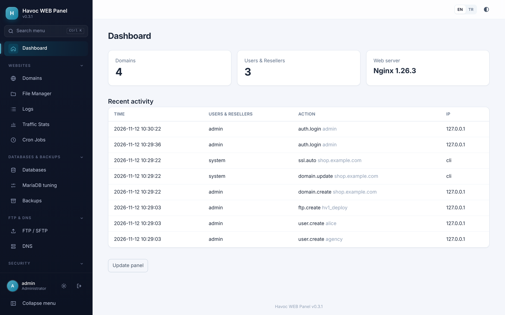

</div>

---

## 💚 Free and open source, for everyone

Havoc WEB Panel is developed by **[Webolye](https://webolye.com/havocwebpanel/)** and released under the **[MIT License](LICENSE)**.

- ✅ **100% free**: no paid edition, no license keys, no per-server or per-domain fees, no telemetry.
- ✅ **Use it anywhere**: on your own servers, for your customers, in your company or hosting business, commercially or not.
- ✅ **Change it as you like**: fork it, re-brand it, add or remove modules, adapt it to your own workflow.
- ✅ **Share it**: redistribute the original or your modified version.

The only condition of the MIT License is that the copyright and license notice stay in copies of the software.
Contributions back to the project are very welcome, but never required.

---

## ✨ Features

<table>
<tr>
<td width="50%" valign="top">

### 🌐 Websites
- Domains, subdomains, addon domains, aliases (parked) and redirects
- **Per-site PHP version** (8.1 – 8.4), extensions, OPcache and `php.ini` settings
- Every site runs in its **own PHP-FPM process** under its own Linux user
- **Automatic Let's Encrypt SSL** when a domain is added, plus renewals, custom certificates and Cloudflare Origin certificates
- Force HTTPS, HSTS, per-site Nginx rules with validation

### 🖥️ Web server of your choice
- **Nginx**, **OpenLiteSpeed** or **LiteSpeed Enterprise**
- One-click install and activation; all sites are rewritten for the new server
- Automatic rollback if the new server does not answer

### 📁 Files & logs
- Advanced **file manager** with a CodeMirror code editor, drag-and-drop chunked uploads (up to 2 GB), zip / tar.gz, search, bulk permissions
- **Log center**: access, error and PHP logs of every site, live viewer with filters, download and cleanup

### ⏱️ Automation
- **Cron jobs** with presets (every minute, 5 / 15 / 30 min, hourly…), a visual builder, human-readable description and next run times, output logs and *Run now*
- Scheduled **backups** (files + databases) to local disk, S3, FTP or SFTP, with one-click restore

</td>
<td width="50%" valign="top">

### 🗄️ Databases & services
- MariaDB databases and users, remote access per database
- One-click **phpMyAdmin** (latest release, behind the panel login)
- **MariaDB performance tuning** with RAM-based profiles and automatic rollback
- **Redis** and **Meilisearch** (one-click install / uninstall)

### 🔐 Security
- Admin / reseller / user roles with strict tenant isolation
- **Two-factor authentication (TOTP)**, brute-force protection, audit log
- CSRF protection, strict Content-Security-Policy, prepared statements, Argon2id
- **ModSecurity WAF** with OWASP CRS, **firewall** (ufw) with lock-out protection
- Privileged actions run through a small, whitelisted root helper; the web panel itself runs unprivileged

### 📡 DNS, FTP & monitoring
- Authoritative **DNS** (BIND9) with record validation
- **FTP** (Pure-FTPd, TLS) and **SFTP** (chrooted) accounts
- Server monitor, service control, resource limits, traffic statistics with CSV export

### 🏢 For hosting companies
- **Resellers**, hosting packages with CPU / RAM / disk / bandwidth limits
- **White-label**: your own name, logo, colour and panel domain
- **REST API** with OpenAPI description
- English & Turkish interface, light & dark theme, mobile friendly

</td>
</tr>
</table>

---

## 📸 Screenshots

<table>
<tr>
<td width="50%">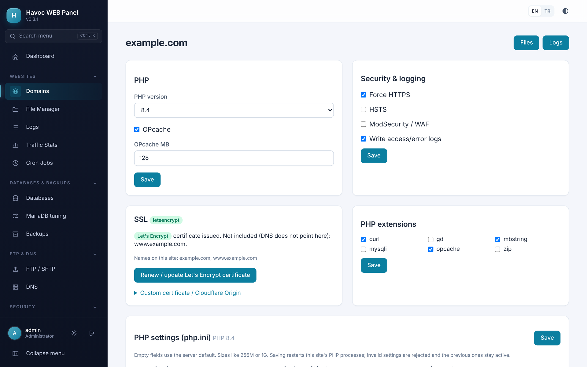<br><sub><b>Domain settings</b>: PHP version, OPcache, extensions, SSL and security in one place.</sub></td>
<td width="50%">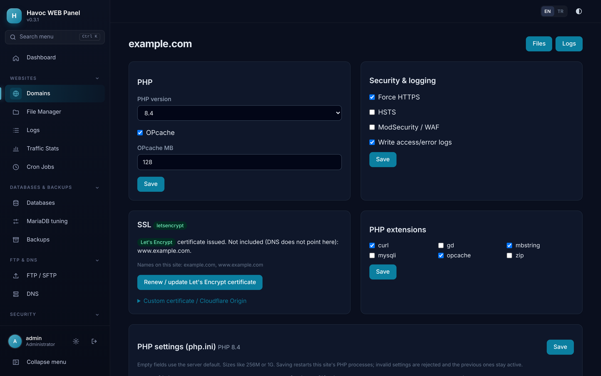<br><sub><b>Dark theme</b>: every page, remembered per user.</sub></td>
</tr>
<tr>
<td>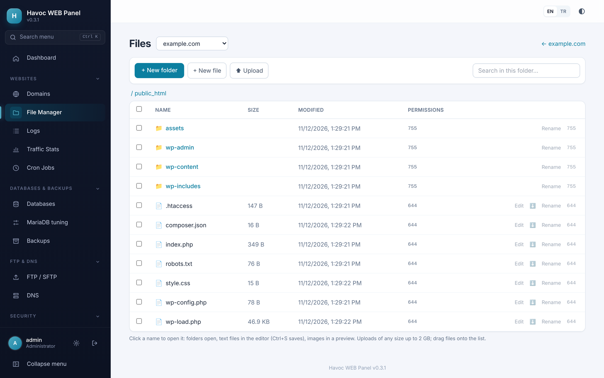<br><sub><b>File manager</b>: upload, edit, compress, extract and set permissions.</sub></td>
<td>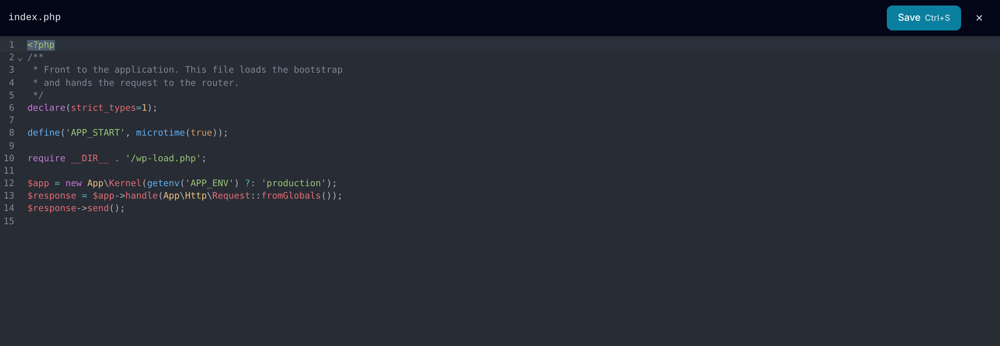<br><sub><b>Code editor</b>: syntax highlighting, <kbd>Ctrl</kbd>+<kbd>S</kbd> to save.</sub></td>
</tr>
<tr>
<td>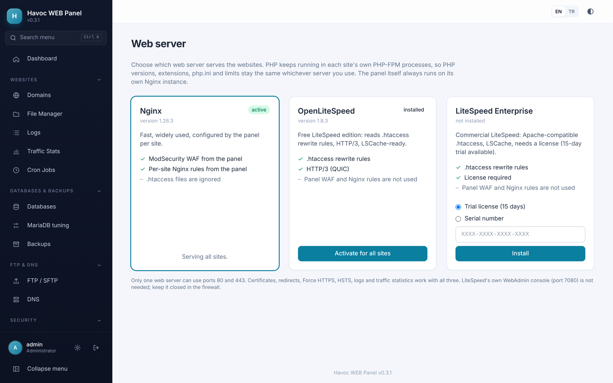<br><sub><b>Web server selection</b>: Nginx, OpenLiteSpeed or LiteSpeed Enterprise.</sub></td>
<td>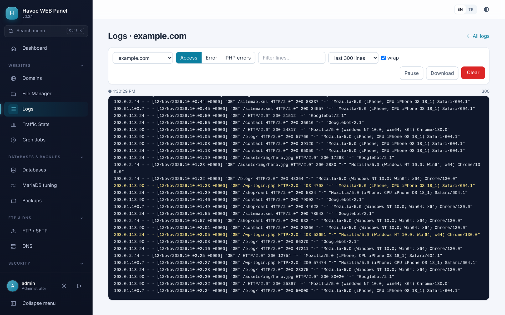<br><sub><b>Live log viewer</b>: access, error and PHP logs with filters.</sub></td>
</tr>
<tr>
<td>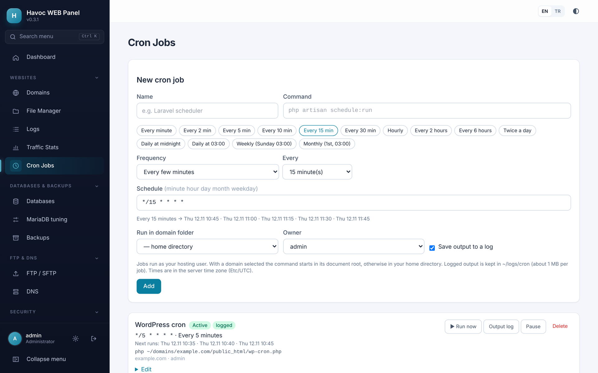<br><sub><b>Cron jobs</b>: presets, schedule builder and next run times.</sub></td>
<td>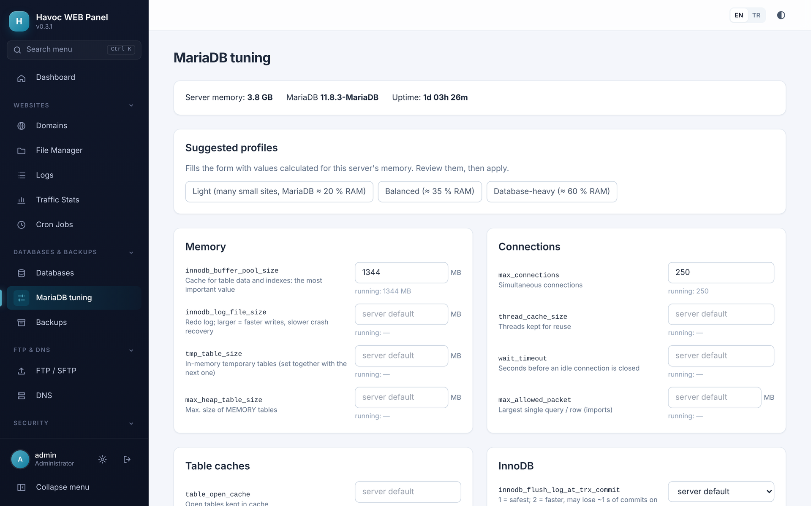<br><sub><b>MariaDB tuning</b>: profiles calculated from the server's memory.</sub></td>
</tr>
<tr>
<td>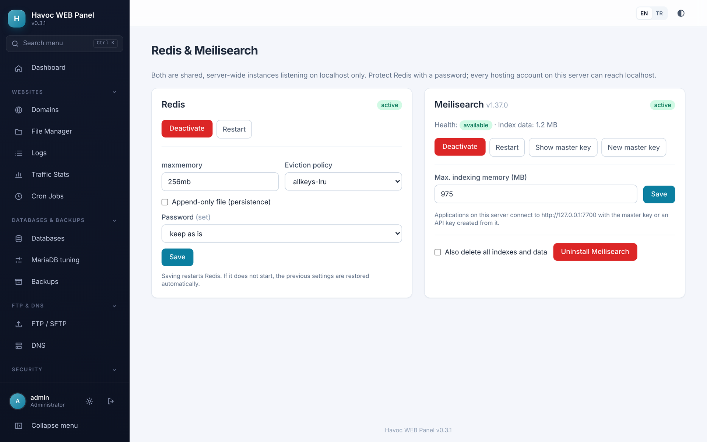<br><sub><b>Redis & Meilisearch</b>: one-click install and configuration.</sub></td>
<td>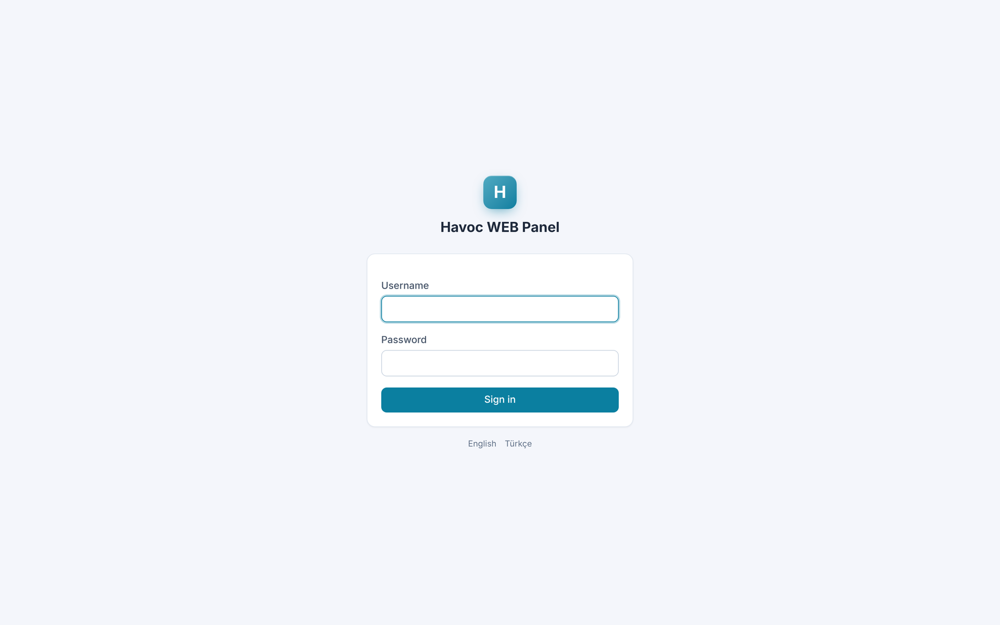<br><sub><b>Login</b>: with optional two-factor authentication.</sub></td>
</tr>
</table>

---

## 📋 Requirements

| | |
|---|---|
| **Operating system** | A fresh **Debian 12 (Bookworm)** or **Debian 13 (Trixie)** server |
| **Access** | `root` (or a user with `sudo`) |
| **Hardware** | 64-bit x86_64 (arm64 is expected to work but is less tested). 1 GB RAM minimum, 2 GB or more recommended |
| **Network** | A public IPv4 address. Ports 80 and 443 (websites) and 2087 (panel) must be reachable |

> ⚠️ Install the panel on a **clean server**. It configures Nginx, PHP-FPM, MariaDB, BIND9, Pure-FTPd, ufw and other services and is not meant to be added to a server that already hosts websites with another panel.

---

## 🚀 Installation

```bash
apt-get update && apt-get install -y git
git clone https://github.com/OWNER/havoc-web-panel.git
cd havoc-web-panel
sudo bash install/install.sh
```

When the installer finishes it prints the panel address and the login data of the `admin` user:

```
Havoc WEB Panel is ready.
  URL:      https://YOUR_SERVER_IP:2087  (self-signed certificate)
  ...
```

Log in, change the password and turn on two-factor authentication under **Settings**.

### Installer options

Options are passed as environment variables:

```bash
sudo HAVOC_WEBSERVER=ols HAVOC_PORT=8443 HAVOC_PHP_VERSIONS="8.3 8.4" bash install/install.sh
```

| Variable | Default | Description |
|---|---|---|
| `HAVOC_WEBSERVER` | `nginx` | Web server for the sites: `nginx`, `ols` (OpenLiteSpeed) or `lsws` (LiteSpeed Enterprise). It can be changed later from the panel. |
| `HAVOC_LSWS_LICENSE` | `TRIAL` | LiteSpeed Enterprise serial number (only with `lsws`) |
| `HAVOC_PHP_VERSIONS` | `8.1 8.2 8.3 8.4` | PHP versions offered to the websites |
| `HAVOC_PORT` | `2087` | HTTPS port of the panel (can be changed later from the panel) |

### Updating

```bash
cd havoc-web-panel
git pull
sudo bash install/upgrade.sh
```

`upgrade.sh` keeps your configuration, encryption key, certificates, database and websites, and runs the database migrations.

> ❗ Never run `install.sh` again on a server that is already in use: it creates a new encryption key, and stored backup credentials could no longer be decrypted. Always update with `upgrade.sh`.

---

## 🏗️ How it works

```
Browser ──HTTPS──▶ havoc-panel-nginx ──▶ havoc-panel-fpm  (user "havoc", unprivileged)
                                              │
                                              │  sudo -n havocctl <action>   (JSON, whitelisted actions)
                                              ▼
                                         havocctl (root helper, strict validation)
                                              ├── web server driver: Nginx │ OpenLiteSpeed │ LiteSpeed
                                              ├── PHP-FPM master per site (own Linux user, cgroup limits)
                                              └── MariaDB, BIND9, Pure-FTPd, ufw, certbot, …
```

- The panel is plain **PHP 8.2+ without a framework**, with **SQLite** for its own data and **Tailwind CSS** for the interface.
- The panel runs as an unprivileged user on its own Nginx instance. Only a small root helper with a fixed list of validated actions can change the system.
- Each hosting account is a separate Linux user, and each site has its own PHP-FPM master with its own `open_basedir`, OPcache and resource limits.

More details: **[Administrator & technical guide](docs/ADMIN-GUIDE.md)** · API description: [`docs/openapi.json`](docs/openapi.json)

---

## 🧭 Project status

Havoc WEB Panel is **beta software (0.x)**. The panel has been installed and used on Debian 13, and every release is checked with automated page tests and a headless browser. Please:

- try it on a **test server** before using it in production,
- keep **backups**, and
- [report problems](../../issues) you run into.

Known limitations:
- OpenLiteSpeed and LiteSpeed Enterprise support is new and has not yet been tested widely on real servers.
- Self-update from the panel needs a published release URL (`HAVOC_UPDATE_URL`); until then, update with `git pull` + `upgrade.sh`.
- No email server (SMTP/IMAP) module yet.

See the [changelog](CHANGELOG.md) for what changed in each version.

---

## 🛠️ Development

```
public/      entry point and compiled assets      src/Core         own mini framework (router, session, CSRF, i18n…)
src/         controllers and services              views/           PHP templates (Tailwind CSS)
ctl/         privileged root helper (havocctl)     lang/            translations (en, tr)
install/     installer and upgrade scripts         database/        SQLite schema and migrations
bin/         CLI and helper scripts                docs/            documentation, screenshots, OpenAPI
```

Rebuild the stylesheet or the editor bundle after changing templates:

```bash
npm install
npm run build          # public/assets/app.css
npm run build:editor   # public/assets/editor.js (CodeMirror)
```

New languages are welcome: copy `lang/en.php`, translate the values and add the code to `I18n::SUPPORTED`.

---

## 🤝 Contributing

Bug reports, ideas, translations and pull requests are all welcome. Please read **[CONTRIBUTING.md](CONTRIBUTING.md)** first.

🔒 **Found a security issue?** Please do not open a public issue. Follow **[SECURITY.md](SECURITY.md)** instead.

---

## 📄 License

Havoc WEB Panel is free software released under the **[MIT License](LICENSE)**.
Copyright © 2026 [Webolye](https://webolye.com/havocwebpanel/).

Third-party components keep their own licenses. See [THIRD_PARTY_NOTICES.md](THIRD_PARTY_NOTICES.md).

This software is provided "as is", without warranty of any kind. You are responsible for the servers you run it on.

---

<div align="center">

Made with ❤️ by **[Webolye](https://webolye.com/havocwebpanel/)**

If Havoc WEB Panel is useful to you, please ⭐ **star the repository** and tell others about it!

</div>
